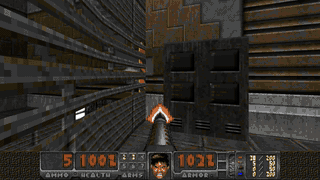

# Bot do Dooma z kanału Boty bez roboty

Skryptowy bot, który przechodzi pierwszy poziom gry Freedoom 2 (MAP01) przez bibliotekę ViZDoom. Cały kod napisał agent AI na nagraniu do filmu. To repozytorium jest stanem projektu z końca filmu razem z całą jego historią, z jedną zmianą: po filmie przetłumaczyliśmy na angielski nazwy plików, kod i komentarze, bez zmiany działania (te same seedy dają te same gry co do tiku). Stan z filmu, z polskimi nazwami, jest pod tagiem `etap-8`, a tabela starych i nowych nazw w [prompts/README.md](prompts/README.md).



Pytania, własne boty i pomysły na kolejne: [Discord kanału Boty bez roboty](https://discord.gg/6QCNXAGntW). Link do filmu dodamy w dniu premiery.

## Co ten bot umie

- Przechodzi MAP01 w około 50 sekund czasu gry. Człowiek, z którym się ścigał, potrzebował 86,5 s.
- Na seedach, których nie widział przy poprawkach, dochodzi do wyjścia w 98-99 grach na 100.
- Na drugim poziomie (MAP02) nie dochodzi do wyjścia ani razu na 20 gier. Zna na pamięć tylko pierwszy poziom.

To zwykły skrypt z regułami. Nie ma w nim uczenia maszynowego ani modelu AI działającego w trakcie gry. Zasady pojedynku, czyli co botowi wolno wiedzieć, są w [goal.md](goal.md): może znać poziom na pamięć jak doświadczony gracz, a w trakcie gry korzysta z tego, co widać na ekranie, i z własnej pozycji.

| Seedy | Wyjścia przed ostatnią poprawką | Wyjścia po niej |
|---|---:|---:|
| 80 znanych agentowi | 71 | 80 |
| 100 odłożonych przez agenta przed poprawką | 87 | 99 |
| 100 niezależnych (sprawdzenie poza nagraniem) | 86 | 98 |

Wszystkie pomiary agenta są w [results.md](results.md).

## Uruchomienie krok po kroku

Sprawdzone na Windows 11 z Pythonem 3.12.10. Na innych systemach nikt tego jeszcze nie próbował. Niczego nie trzeba kupować: biblioteka ViZDoom ma w paczce darmowego Freedooma. Całość zajmuje kilka minut.

### 1. Otwórz PowerShell

Kliknij Start, wpisz `PowerShell` i naciśnij Enter. Wszystkie polecenia poniżej wklejasz do tego okna, po jednym, i zatwierdzasz Enterem.

### 2. Zainstaluj Gita i Pythona 3.12

Jeśli już je masz, pomiń ten krok.

```powershell
winget install -e --id Git.Git
winget install -e --id Python.Python.3.12
```

Windows może zapytać o zgodę na instalację. Po instalacji zamknij PowerShell i otwórz go od nowa, żeby zobaczył nowe programy. Sprawdź, czy działają:

```powershell
git --version
py -3.12 --version
```

Oba polecenia powinny wypisać numer wersji.

### 3. Pobierz projekt

Projekt musi leżeć w folderze o krótkiej ścieżce bez spacji, na przykład `C:\doom-bot`. Przy długiej ścieżce albo spacji w nazwie ViZDoom 1.3.2 na Windowsie gubi powtórki albo się zawiesza.

```powershell
git clone https://github.com/botybezroboty/doom-bot.git C:\doom-bot
cd C:\doom-bot
```

### 4. Zainstaluj paczki

```powershell
py -3.12 -m venv .venv
.\.venv\Scripts\python.exe -m pip install -r requirements.txt
```

Pierwsze polecenie tworzy w folderze projektu osobne środowisko Pythona (`.venv`), żeby nic nie mieszało się z resztą komputera. Drugie pobiera do niego ViZDoom i dwie pomocnicze paczki. Trwa to kilkanaście sekund.

### 5. Uruchom jedną grę

```powershell
.\.venv\Scripts\python.exe bot.py 1002
```

Gra działa bez okna i trwa kilka sekund. Na końcu zobaczysz linię podobną do tej:

```
1002 exit 2209 map01_new_1002_20261115_095802_497024
```

Po kolei: seed, czyli numer gry, od którego zależy zachowanie potworów, potem wynik (`exit` to wyjście z poziomu, `death` to zgon, `timeout` to koniec czasu), liczba tików gry (35 tików to sekunda) i nazwa plików tej gry.

### 6. Obejrzyj, co bot zrobił

```powershell
explorer replays
```

W folderze `replays` każda gra ma trzy pliki:

- `.mp4`: film z gry, otwórz go dwuklikiem,
- `.lmp`: powtórka, z której gra odtworzy całe przejście,
- `.jsonl`: dziennik, tik po tiku: co bot widział, gdzie stał, co zrobił, ile miał życia.

Możesz podać kilka seedów naraz, na przykład `bot.py 1 5 1002`. Część numerów bot odrzuca, bo na Windowsie biblioteka obcina zbyt duże numery i różne seedy dawałyby tę samą grę. Wtedy po prostu podaj inny numer.

### Następnym razem

Wystarczy otworzyć PowerShell i wpisać:

```powershell
cd C:\doom-bot
.\.venv\Scripts\python.exe bot.py 1002
```

## Sprawdzenie wszystkiego jednym poleceniem

```powershell
.\.venv\Scripts\python.exe check_all.py
```

Trwa około trzech i pół minuty. Uruchamia testy celowania, 20 par gier na arenie `defend_the_center` (bot celujący przeciw losowemu) i 20 gier na MAP01 na nowych seedach. Na końcu podaje liczbę wyjść, zgonów i medianę czasu, a najlepszą grę zapisuje jako film. Uwaga: polecenie nadpisuje pliki `proof_center.csv` i `proof_map01.csv`.

## Zagraj sam

```powershell
.\.venv\Scripts\python.exe play_manually.py
```

Otwiera okno, w którym przechodzisz MAP01 na klawiaturze i myszy, a program mierzy czas do naciśnięcia przełącznika wyjścia. Dwa przejścia z filmu leżą w folderze [human-runs](human-runs).

## Zmień coś w bocie

Bot to jeden plik, `bot.py`. Otwórz go w dowolnym edytorze, choćby w Notatniku. Trzy miejsca na początek:

- `ROUTE_NEW` na górze pliku: trasa przez poziom jako lista punktów na mapie,
- funkcja `combat`: do kogo bot celuje i kiedy strzela,
- pętla w funkcji `run`: co bot robi w każdym tiku, w tym zasady dla beczek i strzelby.

Po zmianie puść bota na kilku seedach i porównaj wyniki ze starą wersją na tych samych seedach. Jedna gra nic nie mówi, bo potwory za każdym razem zachowują się inaczej.

## Praca z agentem AI

Bot powstał w aplikacji Codex, ale możesz użyć dowolnego agenta, który pracuje na plikach w folderze. Otwórz w nim folder projektu i pisz, co widzisz i czego chcesz. Zasady, których agent ma się trzymać, są w `AGENTS.md`. Wszystkie prompty z filmu, po kolei i z wynikiem każdego, leżą w [prompts/README.md](prompts/README.md).

Dwie rady z filmu: każ agentowi pytać o zgodę, zanim zrobi coś poza folderem projektu, i nie wierz samemu raportowi. Obejrzyj film z gry.

## Jak się w tym odnaleźć

| Plik | Co to jest |
|---|---|
| `bot.py` | bot do MAP01: trasa, walka, zbieranie, beczki |
| `defend_the_center.py` | pierwszy bot, na prostej arenie, i bot losowy do porównania |
| `check_all.py` | jedno polecenie, które sprawdza oba |
| `play_manually.py` | tryb, w którym grasz sam |
| `goal.md` | cel i zasady pojedynku |
| `results.md` | wszystkie wyniki i diagnozy zapisane przez agenta |
| `AGENTS.md` | zasady projektu dla agenta AI |
| `AGENT-NOTES.md` | opis projektu napisany przez agenta w trakcie pracy |
| `prompts/` | wszystkie prompty z filmu, po kolei, z wynikiem każdego |
| `human-runs/` | dwie powtórki ręcznych przejść |
| `comparison_*.csv`, `reliability_*.csv`, `seeds_*.json` | tabele i listy seedów z kolejnych porównań |

Skrypty `compare_demons.py`, `compare_ammo.py`, `compare_three.py`, `compare_shotgun_final.py`, `diagnose_deaths.py` i część `compare_reliability.py` czytają powtórki z nagrań do filmu. Tych plików nie ma w repozytorium, bo zajmują kilka gigabajtów, więc te skrypty zgłoszą brak pliku. `trial_map02.py` celowo odmawia działania, gdy `bot.py` został zmieniony.

## Historia krok po kroku

Historia commitów jest prawdziwa: 56 commitów agenta, w kolejności i z godzinami z nagrań. Stan projektu po każdym kroku ma swój tag, więc możesz cofnąć się do dowolnego miejsca filmu:

```powershell
git checkout etap-6     # bot, który biegnie do wyjścia i ani razu nie strzela
git checkout krok-7c    # bot przed poprawką z beczkami
git checkout master     # stan końcowy
```

Tagi po kolei: `etap-1`, `etap-2`, `etap-3`, `krok-3b`, `krok-3d`, `etap-4`, `krok-4b`, `etap-5`, `krok-4c`, `krok-4d`, `etap-6`, `krok-6b`, `krok-6c`, `etap-7`, `krok-7b`, `krok-7c`, `krok-7d`, `etap-8`. Który prompt doprowadził do którego tagu, jest w [prompts/README.md](prompts/README.md). Pod tagami pliki mają polskie nazwy z filmu; angielskie są od zmiany po filmie.

## Zadania dla Was

1. Bot dalej przegrywa jedną albo dwie gry na sto. W tych grach stoi pod ostrzałem z pistoletem, zanim zdobędzie pancerz, i powoli traci życie.
2. Na MAP02 nie dochodzi do wyjścia ani razu, bo jego trasa to lista punktów z MAP01.
3. Własny pomysł: inny poziom, inna gra, inne zasady.

Poprawki są mile widziane. Zrób fork, wprowadź zmianę i wyślij pull request. Jak zmierzyć zmianę i co wpisać w pull requeście, jest w [CONTRIBUTING.md](CONTRIBUTING.md). Trzy prośby:

- trzymaj się zasad z `goal.md` albo napisz wprost, którą zmieniasz i dlaczego,
- podaj wynik na seedach, na których niczego nie stroiłeś, obok wyniku obecnej wersji na tych samych seedach,
- jedna zmiana na jeden pull request.

Własnego bota, także do innej gry, pokaż na [Discordzie](https://discord.gg/6QCNXAGntW) w kanale `wasze-boty`.

## Gdy coś nie działa

- `py` albo `git` „nie jest rozpoznawany jako nazwa polecenia”: zamknij PowerShell i otwórz go od nowa po instalacji. Jeśli to nie pomoże, zainstaluj program jeszcze raz (krok 2).
- Gra się zawiesza albo w folderze `replays` nie ma powtórki: projekt leży w długiej ścieżce albo w ścieżce ze spacją. Przenieś go na przykład do `C:\doom-bot`. Autorzy ViZDoom przygotowali już poprawki tego błędu, wejdą do kolejnej wersji biblioteki.
- Bot odrzuca seed z komunikatem o obcięciu seeda silnika: podaj inny numer.
- Polskie znaki w oknie PowerShella są rozsypane: wpisz `$env:PYTHONUTF8 = "1"` przed uruchomieniem.
- Przy starcie silnika gry na moment pojawia się jego okno. Skrypty uruchamiają silnik na osobnym, niewidocznym pulpicie, żeby go nie było widać, więc nie powinno się to zdarzać.

Jeśli nic z tej listy nie pomaga, napisz na [Discordzie](https://discord.gg/6QCNXAGntW) w kanale `pomoc`. Podaj system, wersję Pythona, wpisane polecenie i cały komunikat błędu jako tekst.

## Licencja

Kod z tego repozytorium jest na licencji MIT, patrz [LICENSE](LICENSE). ViZDoom i Freedoom nie są częścią repozytorium, instaluje je `pip`. ViZDoom ma licencję MIT, a silnik ZDoom, na którym stoi, ma własne licencje. Freedoom jest na licencji BSD.

## ViZDoom

Bot działa dzięki bibliotece [ViZDoom](https://github.com/Farama-Foundation/ViZDoom), która powstała na Politechnice Poznańskiej. Jeśli Ci się przyda, zostaw jej gwiazdkę. Autorzy proszą o cytowanie tych prac:

- M. Wydmuch, M. Kempka, W. Jaśkowski, „ViZDoom Competitions: Playing Doom from Pixels”, IEEE Transactions on Games, 2019, [arXiv:1809.03470](https://arxiv.org/abs/1809.03470)
- M. Kempka, M. Wydmuch, G. Runc, J. Toczek, W. Jaśkowski, „ViZDoom: A Doom-based AI Research Platform for Visual Reinforcement Learning”, IEEE CIG 2016, [arXiv:1605.02097](https://arxiv.org/abs/1605.02097)
